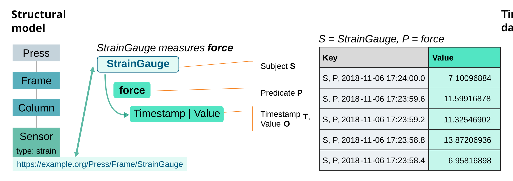

[](https://hub.docker.com/r/linkedfactory/linkedfactory-pod)

# Welcome to the LinkedFactory Pod repository

This is the reference implementation of the 
**[LinkedFactory architecture](https://github.com/linkedfactory/specification)**.

LinkedFactory (LF) is a data architecture concept for structuring time-series data by using semantic descriptions of assets to create connected digital representations of technical systems.

The core idea is to use an RDF knowledge graph for describing the structure of systems with their components and relationships. The components are identified by URIs and may have associated time-series data. To organize these measurements, the component's URI **S** is used as a key in combination with a predicate URI **P** and a timestamp **T** to uniquely qualify values. The resulting composite key is then used to store the associated data in a key-value store or it is mapped to the structure of a tailored time-series database.



## Data representation
Formally, the triple-based data model of RDF _(S, P, O)_ is extended to a quad-based data model _(S, P, T, O)_. If named graphs are used to manage multiple RDF datasets then an additional context **C** can be introduced to extend the data model to _(C, S, P, T, O)_. We call this the **Kvin** data model.

### JSON format
The primary data format is the __LF JSON format__ that uses a nested structure where the first level contains the items and the second level the associated properties with their values:

```json
{
    "http://example.org/resource1": {
       "http://example.org/properties/p1": [
           { "value": 20.4, "time": 1619424246120 },
           { "value": 20.3, "time": 1619424246100 }
       ],
       "http://example.org/properties/p2": [
           { "value": { "msg" : "Error 1", "nr" : 1 }, "time": 1619424246100 }
       ]
    }
}
```

A concrete example for modeling the captured force data of a strain gauge could be represented as:
```json
{
  "https://example.org/Press/Frame/StrainGauge": {
    "p:force" : [{ "value": 7.10096884, "time": 1541521440000 }]
  }
}
```
### RDF format
For representing time-series data in plain RDF the following encoding is used:
```
S P [ <kvin:value> O ; <kvin:time> T ] .
```

The data of the strain gauge example above could then expressed as:
```
@base <https://example.org/Press/Frame/> .

<StrainGauge> <p:force> [ <kvin:value> 7.10096884 ; <kvin:time> 1541521440000 ] .
```

## Data insertion and retrieval
### HTTP APIs
The data can be inserted and queried by using __[HTTP-based APIs](https://linkedfactory.github.io/specification/overview/1/timeseries/api)__.

For inserting the data the LF JSON format can be used as follows:
```sh
curl -H "Content-Type:application/json" http://localhost:8080/linkedfactory/values -d '{
  "https://example.org/Press/Frame/StrainGauge": {
    "p:force" : [{ "value": 7.10096884, "time": 1541521440000 }]
  }
}'
```
If data with the same timestamps should be inserted then the CSV format is more concise:
```sh
curl -H "Content-Type:text/csv" http://localhost:8080/linkedfactory/values -d 'time,<https://example.org/Press/Frame/StrainGauge>@<p:force>
1541521440000, 7.10096884'
```

Retrieving the data in JSON format is possible through a simple GET request:
```sh
curl -G -d "item=https://example.org/Press/Frame/StrainGauge" -d "property=p:force" http://localhost:8080/linkedfactory/values
```

Just specify an accept header to retrieve data in CSV format:
```sh
curl -G -H "Accept:text/csv" -d "item=https://example.org/Press/Frame/StrainGauge" -d "property=p:force" http://localhost:8080/linkedfactory/values
```

### SPARQL
Additionaly, due to the compatiblity with RDF, it is possible to query the data with SPARQL.

```
curl -H "Accept:text/csv" http://localhost:8080/sparql --data-urlencode 'query=
base <https://example.org/Press/Frame/>

select ?time ?value {
  service <kvin:> {
    <StrainGauge> <p:force> [ <kvin:value> ?value ; <kvin:time> ?time ] .
  }
}' --data-urlencode 'model=http://linkedfactory.github.io/data/'
```

## Full-text search
LinkedFactory Pod can index RDF statements for full-text search and expose them to SPARQL via **`SERVICE <fts:...>`**.

Purpose:
- index literal values for keyword search
- keep IRIs and named graph context available for exact-match filtering
- return optional score/snippet bindings
- support external and internal backends through the same SPARQL shape

Linkedfactory-Pod sends the changes to a search server that must expose a bulk endpoint, by default:
- `POST {fts:endpoint}{fts:bulkPath}`
- `Content-Type: application/json`

This endpoint can be configured in linkedfactory-pod via the ttl configuration file with the `fts:endpoint` and `fts:bulkPath` properties of the `fts:FtsSail` configuration.

The Key-Search can be integrated with SPARQL queries using the `SERVICE <fts:...>` syntax.

The following example shows how to query for IRIs that match certain keywords and filter them based on a weight property:

```sparql
prefix fts: <fts:>
prefix dtsc: <https://example.org/dtsc/>

select ?iri ?score where {
  service <fts:> {
    ?iri fts:keywords "some keywords" ;
         fts:score ?score .
  }
  ?iri dtsc:weight ?weight .
  filter (?weight > 50)
}
```

The federated service is configured through the `fts:FtsSail` .

The following example shows how to configure the federated service and the FtsSail:

```ttl
@prefix rep: <http://www.openrdf.org/config/repository#>.
@prefix sr: <http://www.openrdf.org/config/repository/sail#>.
@prefix sail: <http://www.openrdf.org/config/sail#>.
@prefix ns: <http://www.openrdf.org/config/sail/native#>.
@prefix fts: <http://linkedfactory.github.io/config/sail/fts#>.

<urn:enilink:data> a models:RepositoryModelSet ;
    models:repository <urn:linkedfactory:data-repo> .

<urn:linkedfactory:data-repo> a rep:Repository ;
   rep:repositoryID "linkedfactory-data" ;
   rep:repositoryImpl [
      rep:repositoryType "openrdf:SailRepository" ;
       sr:sailImpl [
          sail:sailType "kvin:KvinSail" ;
          sail:delegate [
             sail:sailType "fts:FtsSail" ;
             fts:backend "elastic" ;  # use built-in elasticsearch backend for external Elasticsearch server.
            fts:endpoint "http://localhost:9200" ; # the endpoint of the external search server
            fts:outboxDir "/var/lib/linkedfactory/fts/linkedfactory-data/outbox" ; # durable, store-specific WAL directory
            fts:storeIdentity "linkedfactory-data" ; # stable ID unique to this RDF store/index
            fts:bulkPath "/fts/bulk" ; # the bulk endpoint path for indexing (where linkedfactory sends the changes).
            fts:searchPath "/fts/_search" ; # the search endpoint path for querying .
            fts:defaultLimit 100 ; # the default result size for queries.
            fts:failOnError true ; # fail or log on backend errors.
            sail:delegate [
               sail:sailType "openrdf:NativeStore" ; # the actual RDF store for the data.
               ns:tripleIndexes "cspo,cpos,spoc,posc" # the triple indexes to use for the RDF store.
            ]
          ]
       ]
    ] .
```

Backend selection:
- `fts:backend "elastic"` uses `fts:endpoint` and an HTTP search backend.
- `fts:backend "lucene"` can be added later as a Lucene backend.
- `fts:backend "internal"` can be added later for in-process indexing and should ignore `fts:endpoint`.

Common TTL options:
- `fts:endpoint` search endpoint for external backends
- `fts:searchPath` backend query path
- `fts:bulkPath "/fts/bulk"` is the bulk endpoint path for indexing (where linkedfactory sends the changes and not related to the federated service)
- `fts:defaultLimit` default result size

- `fts:failOnError` legacy synchronous-service behavior; durable WAL delivery always retries asynchronously
- `fts:outboxDir` absolute persistent directory on a filesystem that supports atomic same-directory rename and file/directory synchronization; dedicate it to one RDF store/index, keep it out of temporary storage, and include it in the store's backup/recovery plan
- `fts:storeIdentity` stable identifier for this RDF store/index; it must remain unchanged across restarts and must differ for every store
- `fts:backend "elastic"` selects the current `ElasticHttpFtsIndexUpdateStrategy`; other update strategies must be explicitly implemented and registered

RDF commits only wait for the local WAL to be durable. A background worker applies remote updates in RDF commit order and retries failures. Keep the WAL directory on persistent storage; startup fails if a committed RDF journal marker has no matching WAL record or the directory ownership does not match. The file coordinator requires atomic same-directory rename, file and directory synchronization, and cooperating processes that honor OS file locks; use a local filesystem with those guarantees and dedicate one outbox directory to each store.

Backend providers implement `FtsIndexUpdateStrategyFactory` and register it through Java `ServiceLoader` in `META-INF/services/io.github.linkedfactory.core.rdf4j.fts.config.FtsIndexUpdateStrategyFactory`. In OSGi, provider descriptors are also enumerated from installed bundles and classes are loaded by their declaring bundle classloader; the core bundle includes the Elasticsearch provider descriptor. Common infrastructure does not need to change when adding a backend. The strategy applies idempotent logical updates, while the coordinator owns durability, ordering, retries, and recovery. A failed earlier update blocks later updates until it succeeds. `FtsSail` accepts an `FtsIndexUpdateCoordinatorFactory` for selecting a different coordinator; the default is `FileFtsIndexUpdateCoordinatorFactory`, whose shutdown grace period is configurable.

Monitor `FtsSail.getOutboxStatus()` for durable record count, pending count, record bytes, total outbox directory bytes, oldest pending-record age and sequence, delivery failure count, last successful delivery time, recovery duration, and the most recent delivery or recovery error. Alert on growing WAL size/age and repeated delivery failures, and provision disk capacity for prolonged backend outages. Successfully acknowledged `.done` records and their RDF journal markers are removed immediately; this is the retention policy, and cleanup never runs before backend application succeeds. Unfinished records are retained for restart recovery. For a poison update, inspect the recorded error and matching WAL transaction, correct the backend or mapping issue, then call `FtsSail.recoverFtsTransactions()` or restart the Sail to replay it. Do not delete, edit, or skip a pending WAL record to unblock later updates: strict sequence ordering is required to preserve index consistency. Recovery validates the complete WAL and RDF journal before changing record states.

An FTS activation error after the RDF commit means the RDF data is committed but its durable prepared WAL record still requires recovery; that connection is unusable and should be closed. Recovery belongs to the Sail-level coordinator and can proceed while the Sail remains running. Shutdown stops new work, waits for the configured grace period, requests interruption, and leaves incomplete WAL state untouched; if delivery or journal cleanup does not stop, its resources are deliberately left open. `FtsSail` waits for coordinator termination before shutting down the base Sail because journal cleanup may still need it; this final wait can exceed the grace period when a callback ignores interruption.

The HTTP backend's default socket inactivity timeout is 300 seconds (`fts:requestTimeoutMillis`); connection establishment and pool acquisition each have a 5-second timeout. The socket timeout is not a total request deadline. The default coordinator shutdown grace is 10 seconds per wait (graceful wait, then another wait after interruption), but `FtsSail` intentionally waits for an active callback to terminate before closing the RDF store. Configure the service manager's stop timeout above the expected in-flight delivery duration plus both coordinator waits and process-shutdown overhead (allow at least 330 seconds for a stalled request with defaults), but note that this is not a hard upper bound: a strategy or HTTP request that ignores interruption or continues making progress can take longer. Configure a shorter backend timeout when faster shutdown is required, and rely on the durable WAL to replay unfinished work after a forced process stop.

`fts:FtsSail` can also be used with in-memory stores by wrapping `openrdf:MemoryStore` instead of `NativeStore`.

The bulk request format is an `operations` array containing `upsert`, `remove`, `clear`, and `clearContexts` entries. Named graph context is included per statement as `context`.

Query-time endpoint override is also supported with `SERVICE <fts:http://host:9200>`, but internal backends can ignore that value.

_**Note**_: the payload (JSON) of the search request used by the federated service is just now for testing and need to be discussed or agreed on. The same applies to the bulk request payload. see examples in `bundles/io.github.linkedfactory.core/src/test/resources/fts/`

## Docker
* We provide containers on [Docker Hub](https://hub.docker.com/r/linkedfactory/linkedfactory-pod)
* `docker run -p 8080:8080 -v /tmp/workspace:/linkedfactory-pod/workspace linkedfactory/linkedfactory-pod`

## Building
* This is a plain Maven project
* a full build can be executed via `mvn package`
* KVIN ingestion benchmark instructions are in [docs/benchmarks/kvin-ingestion.md](docs/benchmarks/kvin-ingestion.md)

## Running 
* change to the folder `launch/equinox`
* run `mvn test -Pconfigure -DskipTests` to initialize or update a launch configuration
* run `mvn test` to (re-)start the POD instance
* The application should now be available at: [http://localhost:8080/linkedfactory/](http://localhost:8080/linkedfactory/)

## Developing
* The project can be developed with any IDE supporting Java and Scala projects
* **IDEA:** `File > Project from existing sources...`
* **Eclipse:** `File > Import > Maven > Existing Maven Projects`
