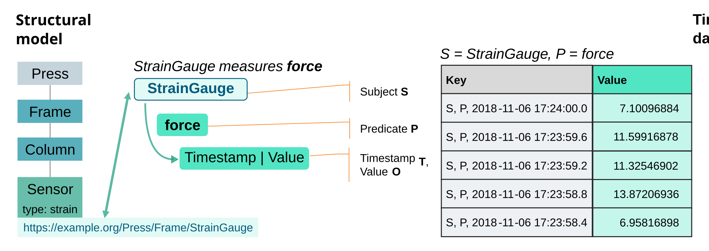

[](https://hub.docker.com/r/linkedfactory/linkedfactory-pod)

# LinkedFactory Pod

LinkedFactory Pod is the reference implementation of the **[LinkedFactory architecture](https://github.com/linkedfactory/specification)**.

It links RDF descriptions of industrial assets with their time-series measurements: components are identified by IRIs, and the same IRIs, combined with a property and a timestamp, identify measured values. Asset descriptions and measurements can then be queried together, for example with SPARQL.



## Quickstart

```sh
docker run -p 8080:8080 -v /tmp/workspace:/linkedfactory-pod/workspace linkedfactory/linkedfactory-pod
```

Open http://localhost:8080/linkedfactory/ and continue with the quickstart in the documentation.

## Documentation

The documentation is in [`docs/`](docs/) (Antora, AsciiDoc):

- **Users:** installation, quickstart, tutorials, how-to guides, API and configuration reference, concepts
- **Contributors:** build, testing, internals, extension points, release process

Good entry points:

- [Overview](docs/modules/ROOT/pages/index.adoc)
- [KVIN data model](docs/modules/explanation/pages/kvin-data-model.adoc)
- [Time-series API](docs/modules/reference/pages/time-series-api.adoc)
- [Full-text search](docs/modules/how-to/pages/enable-full-text-search.adoc)

## Contributing

See [CONTRIBUTING.md](CONTRIBUTING.md) for building, running, and submitting changes.
