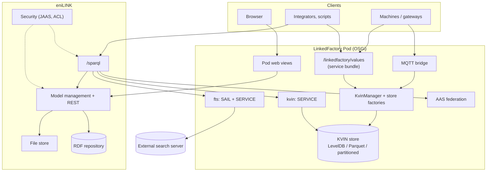

# LinkedFactory Pod Documentation Implementation Plan

> **For agentic workers:** REQUIRED SUB-SKILL: Use diataxis:subagent-driven-development (recommended) or diataxis:executing-plans to implement this plan task-by-task. Steps use checkbox (`- [ ]`) syntax for tracking.

---

This plan is a counter-proposal to the initial documentation in PR #68 (branch `docs`).
It keeps the Antora/AsciiDoc toolchain and the existing page content, and reorganises the pages by audience (users vs. contributors) and by Diátaxis type (tutorial, how-to, reference, explanation).

## Project Summary

- **Purpose:** Reference implementation of the [LinkedFactory architecture](https://github.com/linkedfactory/specification). Pod links RDF descriptions of industrial assets with time-series measurements through shared IRIs.
- **Users:**
  - *Integrators* who push measurements from machines (HTTP, MQTT) and query them (HTTP, SPARQL).
  - *Modellers* who describe assets in RDF/OWL.
  - *Operators* who run Pod (Docker, configuration, storage, security).
  - *Contributors* who build, test, extend, and release Pod.
- **Core concepts:** KVIN data model `(C, S, P, T, O)`; LF JSON and CSV formats; models (named graphs) managed by eniLINK; `SERVICE <kvin:>` joins RDF with measurements; optional full-text search via `SERVICE <fts:>`; optional AAS federation.
- **Core workflow:** start Pod → ingest measurements → describe assets → query both together.

## System Architecture Summary

- **Platform:** Eclipse Equinox/OSGi application built with Maven/bnd. eniLINK provides model management, SPARQL endpoint, security, Lift web framework, file store, optional LDP.
- **Bundles:**
  - `io.github.linkedfactory.core` – KVIN stores (LevelDB, Parquet, partitioned, remote HTTP client), RDF4J integration (`kvin:` SAIL and SERVICE, `fts:` SAIL, AAS federation), CLI (`copy`, `fetch`).
  - `io.github.linkedfactory.service` – Lift module, `/linkedfactory/values` REST API, store factories, MQTT bridge, web views, configuration (`OSGI-INF/*-default.ttl`).
  - `io.github.linkedfactory.opcua` – OPC UA NodeSet → RDF conversion.
- **Runtime entry points:** Docker image `linkedfactory/linkedfactory-pod`, `docker/docker-compose.yml`, local launch via `launch/equinox` (`mvn test`).
- **Configuration entry points:** `configurations/*.ttl` (repository and SAIL chain, incl. FTS), `jaas.conf` (login), service bundle default TTL (store selection), system properties such as `enilink.loginrequired`.
- **Extension points:** `IKvinFactory` (store implementations), FTS backends (`fts:backend`), RDF4J SAIL chain, SPARQL SERVICE handlers.



## Toolchain Detection

- **Docs:** Antora component (`antora.yml`) with AsciiDoc pages, partials, and cross-module `xref`s. No playbook and no docs CI in this repository.
- **Sister site:** `linkedfactory/specification` publishes an Antora site to GitHub Pages using the UI bundle from `linkedfactory/linkedfactory-docs-ui`. The Pod component can be added there as a second content source.
- **Build and test:** Maven (`mvn package`, `mvn verify` in `verify.yml`), JMH benchmarks, unit tests in `src/test` of core and opcua bundles.
- **Release:** `deploy.yml` publishes Maven artefacts on `v*` tags and the `snapshots` branch; `docker.yml` builds the image.
- **Gaps:** Mermaid is not rendered (no extension); `README.md` and `docs/benchmarks/*.md` are Markdown outside the Antora component.

## Existing Documentation

### Catalogue

| File | Purpose | Classification |
|---|---|---|
| `README.md` | Project intro, KVIN data model, LF JSON/RDF formats, HTTP and SPARQL examples, full-text search, Docker, build, run, IDE setup | Mixed (explanation, how-to, reference, contributor) |
| `docs/assets/lf-linking.svg` | Diagram linking assets and measurements | Image (explanation) |
| `docs/benchmarks/kvin-ingestion.md` | Run and interpret the JMH ingestion benchmarks | Mixed (contributor how-to + reference) |
| `docs-site/modules/ROOT/pages/index.adoc` | Landing page, Pod vs. eniLINK responsibilities, entry links | Explanation (landing) |
| `docs-site/modules/ROOT/pages/architecture.adoc` | Logical architecture, storage paths, query integration | Explanation |
| `docs-site/modules/ROOT/pages/quickstart.adoc` | Start a local Pod with Docker | Tutorial (getting started) |
| `docs-site/modules/ROOT/pages/sources.adoc` | Map Pod-facing features to eniLINK source files at a pinned revision | Reference (maintainer) |
| `docs-site/modules/user-guide/pages/ingesting-data.adoc` | Write sample measurements | How-to (part of a linear path) |
| `docs-site/modules/user-guide/pages/modeling-assets.adoc` | Describe the sample sensor in RDF | How-to (part of a linear path) |
| `docs-site/modules/user-guide/pages/querying-data.adoc` | Retrieve and join data via HTTP and SPARQL, troubleshooting | Mixed (how-to + troubleshooting) |
| `docs-site/modules/platform-basics/pages/semantic-concepts.adoc` | Models, imports, identifiers | Explanation |
| `docs-site/modules/platform-basics/pages/managing-models.adoc` | Work with eniLINK models | How-to |
| `docs-site/modules/platform-basics/pages/sparql.adoc` | Submit queries and updates; request forms, formats, errors | Mixed (how-to + reference) |
| `docs-site/modules/platform-basics/pages/access-control.adoc` | Replace defaults, permissions, accounts, verification | Mixed (how-to + explanation) |
| `docs-site/modules/platform-basics/pages/configuration.adoc` | Config discovery, storage separation, timeouts, login, bundles | Mixed (reference + explanation) |
| `docs-site/modules/platform-basics/pages/web-ui.adoc` | Use Pod views and eniLINK tools | How-to |
| `docs-site/modules/api-reference/pages/rest.adoc` | Interface map, representations, errors | Reference |
| `docs-site/modules/api-reference/pages/time-series.adoc` | `/linkedfactory/values` parameters and formats | Reference |
| `docs-site/modules/api-reference/pages/models.adoc` | Model import/export routes plus procedures | Mixed (reference + how-to) |
| `docs-site/modules/api-reference/pages/files.adoc` | File routes plus upload/link procedure | Mixed (reference + how-to) |
| `docs-site/modules/api-reference/pages/json-ld.adoc` | JSON-LD asset descriptions vs. LF JSON | Mixed (reference + explanation) |
| `docs-site/modules/api-reference/pages/ldp.adoc` | Optional LDP integration | Mixed (explanation + reference) |
| `docs-site/modules/*/partials/*.adoc` | Shared snippets (connection, namespaces, auth, upstream scope) | Partials |

### Structural problems

- **No contributor documentation.** Build, run, and IDE setup exist only as README bullets. No `CONTRIBUTING.md`, no repository structure, testing, release, or extension guide. The benchmark guide sits outside the docs component.
- **Modules mix audiences and types.** `platform-basics` groups pages by provider (eniLINK) instead of by user need; it contains explanation, how-to, and reference side by side. `api-reference` contains procedures.
- **Implicit tutorial.** Quickstart → ingest → model → query is a linear learning path ("use the sample data from the previous page") but is presented as independent user-guide pages.
- **Duplicated content.** README repeats data model, formats, HTTP and SPARQL examples that the docs also cover; both will drift.
- **Missing features.** Full-text search (only in README), Parquet and partitioned stores, MQTT bridge, OPC UA NodeSet import, CLI, AAS federation, Docker Compose deployment are undocumented in the docs component.
- **No troubleshooting entry point.** Error handling is spread over `querying-data`, `sparql`, `rest`, `time-series`.
- **Maintainer content in user navigation.** `sources.adoc` (upstream source evidence) is aimed at doc maintainers.
- **Two doc roots.** `docs/` (assets, benchmarks) and `docs-site/` (Antora) with unclear split.
- **Tone.** 35 NOTE/IMPORTANT blocks; many defensive disclaimers dilute the important warnings (default credentials, in-memory model set).
- **No build or publish path.** No playbook, no CI build, Mermaid not rendered.

## Documentation Architecture

### Vision

The documentation serves two audiences.
**Users** (integrators, modellers, operators) learn to run Pod, write measurements, describe assets, and query both together, and find exact interface details when integrating.
**Contributors** learn how Pod is built on OSGi and eniLINK, how to build, test, and extend it, and how releases and the docs themselves are produced.

### Top-level navigation

The Antora component `linkedfactory-pod` has one module per section. Audience is visible in the navigation: everything above *Development* is for users.

```text
Section: Home / Getting started        (module ROOT)        audience: users
Purpose: Orientation and first running Pod.
Contains: landing page, Pod vs. eniLINK overview, installation options, quickstart.
Excludes: detailed procedures, interface details.

Section: Tutorials                     (module tutorials)   audience: users
Purpose: Guided learning path with a guaranteed outcome.
Contains: end-to-end lessons built on the sample strain gauge.
Excludes: alternatives, options, troubleshooting.

Section: How-to guides                 (module how-to)      audience: users, operators
Purpose: Accomplish a specific task.
Contains: ingest, model, query, search, store selection, security, deployment, troubleshooting.
Excludes: conceptual background, exhaustive parameter lists.

Section: Reference                     (module reference)   audience: users, integrators
Purpose: Exact description of interfaces and configuration.
Contains: HTTP routes, formats, SPARQL endpoint, configuration vocabularies, CLI, namespaces.
Excludes: procedures, rationale.

Section: Explanation                   (module explanation) audience: users
Purpose: Build the mental model.
Contains: KVIN data model, architecture, semantic concepts, storage and persistence, security model.
Excludes: step-by-step instructions.

Section: Development                   (module development) audience: contributors
Purpose: Modify, extend, test, release Pod and its docs.
Contains: repository structure, build and run, testing, benchmarks, internals, extension guides, release, docs conventions, upstream baseline, ADRs.
Excludes: end-user procedures.
```

Pages provided by eniLINK (models, SPARQL, access control, files, LDP, web UI) are kept but labelled with a "Platform (eniLINK)" group in each module's navigation, so readers still see which component is responsible.

### Learning architecture

1. First page: `ROOT:index` (what Pod is, which interface for which job).
2. First success: `ROOT:quickstart` – running Pod and one stored measurement.
3. Core tutorial: `tutorials:first-asset` – write measurements, describe the sensor, join both in one SPARQL query. It reuses the material of the three current user-guide pages as one continuous lesson.
4. Supporting explanation before/after the tutorial: `explanation:kvin-data-model`, `explanation:semantic-concepts`.
5. Exits: tutorial ends with links into how-to (ingest at scale, query patterns, search) and reference (time-series API, SPARQL endpoint).

### Task architecture

```text
Task group: Get data in
User goal: Store measurements from machines and files.
Likely documents: ingest measurements (HTTP JSON/CSV), connect MQTT, import OPC UA NodeSets, copy data with the CLI.
Related reference: time-series API, LF JSON/CSV formats, CLI.
Related explanation: KVIN data model.

Task group: Describe assets
User goal: Create and maintain RDF/OWL models.
Likely documents: model assets, manage models, attach files.
Related reference: models API, JSON-LD, files API.
Related explanation: semantic concepts.

Task group: Query and search
User goal: Retrieve and combine data.
Likely documents: query data, use SPARQL, enable full-text search.
Related reference: SPARQL endpoint, full-text search configuration, HTTP interfaces.
Related explanation: architecture (query integration).

Task group: Operate Pod
User goal: Run Pod reliably and securely.
Likely documents: deploy with Docker Compose, choose a time-series store, configure persistence, secure a deployment, use the web UI, troubleshoot.
Related reference: configuration reference, namespaces.
Related explanation: storage and persistence, security model.
```

### Conceptual architecture

- KVIN data model: RDF triple extended by time and context; LF JSON as the wire format.
- Two storage paths: RDF repository (descriptions) and KVIN store (measurements), joined by IRIs.
- Pod as an eniLINK application: what comes from the platform, what Pod adds.
- Models, imports, identifiers (existing page).
- Persistence: in-memory model set by default vs. persistent KVIN store.
- Security model: eniLINK identity, model ACLs, endpoint boundary.

### Reference architecture

- HTTP interfaces overview (route map, representations, errors)
- Time-series API and LF JSON/CSV formats
- Models API, JSON-LD, files API, LDP (eniLINK)
- SPARQL endpoint (request forms, formats, `SERVICE <kvin:>`, `SERVICE <fts:>`)
- Configuration reference (platform TTL, store factories, FTS SAIL, system properties)
- CLI reference
- Namespaces and identifier conventions

### Contributor and developer architecture

- `CONTRIBUTING.md` in the repository root (short, Markdown, links into the development module).
- Development module: overview, repository structure, build and run locally, testing, benchmarks, architecture internals, extending (stores, FTS backends), release process, documentation guide, upstream baseline, ADRs.

### Evaluation against existing documentation

- **Reuse:** all PR #68 pages are kept; most move to another module.
- **Move:** user-guide pages → how-to; `semantic-concepts`, `architecture` → explanation; API pages → reference; `sources` → development; benchmarks → development; `lf-linking.svg` → ROOT images.
- **Split (follow-up):** `sparql` (how-to vs. reference), `configuration` (reference vs. explanation), `access-control` (how-to vs. explanation), `models` and `files` (route reference vs. procedures), `querying-data` (troubleshooting section).
- **Merge (follow-up):** the three user-guide pages feed the tutorial `first-asset`.
- **Remove:** duplicated README sections (data model, formats, HTTP/SPARQL examples, FTS) after they live in the docs.
- **Missing:** tutorials, troubleshooting, data model explanation, configuration and CLI reference, MQTT, OPC UA, stores, FTS, Docker Compose, all contributor pages.
- **Ambiguity resolved:** module names now state the content type; eniLINK ownership is shown as a navigation group instead of a module.

## Documentation Plan

### Hierarchy

```text
Home (ROOT)                                   [users]
  - LinkedFactory Pod                         index.adoc
  - Install Pod                               installation.adoc
  - Quickstart                                quickstart.adoc
Tutorials (tutorials)                         [users]
  - Your first asset: measurements meet RDF   first-asset.adoc
How-to guides (how-to)                        [users, operators]
  - Get data in
    - Ingest measurements                     ingest-measurements.adoc
    - Connect an MQTT broker                  connect-mqtt.adoc
    - Import an OPC UA NodeSet                import-opcua-nodeset.adoc
    - Copy data with the CLI                  copy-data-with-cli.adoc
  - Describe assets
    - Model assets                            model-assets.adoc
  - Query and search
    - Query Pod data                          query-data.adoc
    - Enable full-text search                 enable-full-text-search.adoc
  - Operate Pod
    - Deploy with Docker Compose              deploy-with-docker-compose.adoc
    - Choose a time-series store              choose-time-series-store.adoc
    - Troubleshoot common problems            troubleshoot.adoc
  - Platform (eniLINK)
    - Manage RDF and OWL models               manage-models.adoc
    - Use the SPARQL interface                use-sparql.adoc
    - Secure a deployment                     secure-deployment.adoc
    - Navigate the web interface              use-web-ui.adoc
Reference (reference)                         [users, integrators]
  - Pod interfaces
    - HTTP interfaces                         http-interfaces.adoc
    - Time-series API                         time-series-api.adoc
    - SPARQL endpoint                         sparql-endpoint.adoc
    - Full-text search                        full-text-search.adoc
    - CLI                                     cli.adoc
    - Configuration                           configuration.adoc
  - Platform (eniLINK)
    - RDF model import and export             models-api.adoc
    - File attachments                        files-api.adoc
    - JSON-LD asset descriptions              json-ld.adoc
    - Linked Data Platform                    ldp.adoc
Explanation (explanation)                     [users]
  - KVIN data model                           kvin-data-model.adoc
  - Architecture                              architecture.adoc
  - Models, imports, and identifiers          semantic-concepts.adoc
  - Storage and persistence                   storage-and-persistence.adoc
  - Security model                            security-model.adoc
Development (development)                     [contributors]
  - Overview                                  index.adoc
  - Repository structure                      repository-structure.adoc
  - Build and run locally                     build-and-run.adoc
  - Testing                                   testing.adoc
  - Benchmarks                                benchmarks.adoc
  - Architecture internals                    internals.adoc
  - Extending Pod                             extending.adoc
  - Release process                           release.adoc
  - Writing documentation                     documentation.adoc
  - eniLINK source baseline                   upstream-baseline.adoc
Repository root                               [contributors]
  - README.md, CONTRIBUTING.md
```

Partials move to `ROOT/partials/` so every module includes them the same way. Images move to `ROOT/images/`.

### Documents

All paths are relative to `docs/modules/`.

#### Home

```text
Title: LinkedFactory Pod
File: ROOT/pages/index.adoc
Diátaxis classification: explanation (landing)
Purpose: Orient new readers and route them by role.
Contents: what Pod is; Pod vs. eniLINK table; start here by role (user / operator / contributor)
Depends on: –
Related documents: installation, quickstart, kvin-data-model
Priority: Required
Status: Existing (update links, add contributor entry)

Title: Install Pod
File: ROOT/pages/installation.adoc
Diátaxis classification: how-to
Purpose: Choose and perform an installation (Docker image, Docker Compose, from source).
Contents: Docker image; Docker Compose; from source (link to development:build-and-run)
Depends on: –
Related documents: quickstart, deploy-with-docker-compose
Priority: Required
Status: New
Transformation: Type: Move  Source: README.md#Docker  Target: ROOT/pages/installation.adoc  Reason: installation belongs in the docs, README links to it.

Title: Quickstart
File: ROOT/pages/quickstart.adoc
Diátaxis classification: tutorial
Purpose: First running Pod and first measurement.
Depends on: installation
Related documents: tutorials:first-asset
Priority: Required
Status: Existing (point onward to the tutorial)
```

#### Tutorials

```text
Title: Your first asset: measurements meet RDF
File: tutorials/pages/first-asset.adoc
Diátaxis classification: tutorial
Purpose: One continuous lesson from measurement to joined SPARQL query using the strain gauge example.
Contents: write two measurements; describe the sensor; read via HTTP; join in SPARQL; what you learned
Depends on: quickstart
Related documents: how-to:ingest-measurements, how-to:query-data, explanation:kvin-data-model
Priority: Required
Status: New (stub)
Transformation: Type: Merge  Source: user-guide/pages/{ingesting-data,modeling-assets,querying-data}.adoc  Target: tutorials/pages/first-asset.adoc  Reason: the three pages already form one linear lesson; the how-to pages keep the task-oriented content.
```

#### How-to guides

```text
Title: Ingest measurements | File: how-to/pages/ingest-measurements.adoc | how-to | Required | Existing
Transformation: Move user-guide/pages/ingesting-data.adoc. Follow-up: add CSV variant, remove tutorial-style "sample" framing.

Title: Model assets | File: how-to/pages/model-assets.adoc | how-to | Required | Existing
Transformation: Move user-guide/pages/modeling-assets.adoc.

Title: Query Pod data | File: how-to/pages/query-data.adoc | how-to | Required | Existing
Transformation: Move user-guide/pages/querying-data.adoc. Follow-up: Split "Diagnose missing results" into troubleshoot.adoc.

Title: Enable full-text search | File: how-to/pages/enable-full-text-search.adoc | how-to | Required | New
Contents: prerequisites (search server); add fts:FtsSail to the repository config; query with SERVICE <fts:>
Transformation: Move README.md#Full-text-search (procedure part). Reason: feature undocumented in docs.

Title: Connect an MQTT broker | File: how-to/pages/connect-mqtt.adoc | how-to | Recommended | New (stub)
Source in code: bundles/io.github.linkedfactory.service/.../mqtt/MqttEventBridge.scala

Title: Import an OPC UA NodeSet | File: how-to/pages/import-opcua-nodeset.adoc | how-to | Recommended | New (stub)
Source in code: bundles/io.github.linkedfactory.opcua/.../NodeSetToRdf.java

Title: Copy data with the CLI | File: how-to/pages/copy-data-with-cli.adoc | how-to | Optional | New (stub)
Source in code: bundles/io.github.linkedfactory.core/.../cli/CLI.java (commands copy, fetch)

Title: Deploy with Docker Compose | File: how-to/pages/deploy-with-docker-compose.adoc | how-to | Recommended | New (stub)
Source in code: docker/docker-compose.yml

Title: Choose a time-series store | File: how-to/pages/choose-time-series-store.adoc | how-to | Recommended | New (stub)
Source in code: service/config/Kvin{LevelDb,Parquet,Partitioned}Factory.java

Title: Troubleshoot common problems | File: how-to/pages/troubleshoot.adoc | how-to | Recommended | New (stub)
Transformation (follow-up): Merge error sections from query-data, use-sparql, http-interfaces, time-series-api.

Title: Manage RDF and OWL models | File: how-to/pages/manage-models.adoc | how-to | Required | Existing
Transformation: Move platform-basics/pages/managing-models.adoc.

Title: Use the SPARQL interface | File: how-to/pages/use-sparql.adoc | how-to | Required | Existing
Transformation: Move platform-basics/pages/sparql.adoc. Follow-up: Split request forms, formats, errors into reference:sparql-endpoint.

Title: Secure a deployment | File: how-to/pages/secure-deployment.adoc | how-to | Required | Existing
Transformation: Move platform-basics/pages/access-control.adoc. Follow-up: Split concepts into explanation:security-model.

Title: Navigate the web interface | File: how-to/pages/use-web-ui.adoc | how-to | Optional | Existing
Transformation: Move platform-basics/pages/web-ui.adoc.
```

#### Reference

```text
Title: HTTP interfaces | File: reference/pages/http-interfaces.adoc | reference | Required | Existing | Move api-reference/pages/rest.adoc
Title: Time-series API | File: reference/pages/time-series-api.adoc | reference | Required | Existing | Move api-reference/pages/time-series.adoc
Title: SPARQL endpoint | File: reference/pages/sparql-endpoint.adoc | reference | Required | New (stub) | Split (follow-up) from how-to/use-sparql.adoc
Title: Full-text search | File: reference/pages/full-text-search.adoc | reference | Required | New | Move README.md#Full-text-search (configuration properties, backends, bulk format)
Title: CLI | File: reference/pages/cli.adoc | reference | Optional | New (stub)
Title: Configuration | File: reference/pages/configuration.adoc | reference | Required | Existing | Move platform-basics/pages/configuration.adoc. Follow-up: Split storage rationale into explanation:storage-and-persistence.
Title: RDF model import and export | File: reference/pages/models-api.adoc | reference | Required | Existing | Move api-reference/pages/models.adoc. Follow-up: Split procedures into a how-to.
Title: File attachments | File: reference/pages/files-api.adoc | reference | Recommended | Existing | Move api-reference/pages/files.adoc. Follow-up: Split upload procedure into a how-to.
Title: JSON-LD asset descriptions | File: reference/pages/json-ld.adoc | reference | Recommended | Existing | Move api-reference/pages/json-ld.adoc
Title: Linked Data Platform | File: reference/pages/ldp.adoc | reference | Optional | Existing | Move api-reference/pages/ldp.adoc
```

#### Explanation

```text
Title: KVIN data model | File: explanation/pages/kvin-data-model.adoc | explanation | Required | New
Contents: from triples to (C,S,P,T,O); LF JSON; RDF encoding of values; relation to the specification
Transformation: Move README.md#Data-representation. Reason: core concept, currently only in README.

Title: Architecture | File: explanation/pages/architecture.adoc | explanation | Required | Existing | Move ROOT/pages/architecture.adoc
Title: Models, imports, and identifiers | File: explanation/pages/semantic-concepts.adoc | explanation | Required | Existing | Move platform-basics/pages/semantic-concepts.adoc
Title: Storage and persistence | File: explanation/pages/storage-and-persistence.adoc | explanation | Recommended | New (stub)
Title: Security model | File: explanation/pages/security-model.adoc | explanation | Recommended | New (stub)
```

#### Development

```text
Title: Overview | File: development/pages/index.adoc | explanation | Required | New
Title: Repository structure | File: development/pages/repository-structure.adoc | reference | Required | New
Title: Build and run locally | File: development/pages/build-and-run.adoc | how-to | Required | New | Move README.md#Building, #Running, #Developing
Title: Testing | File: development/pages/testing.adoc | how-to | Required | New (stub)
Title: Benchmarks | File: development/pages/benchmarks.adoc | how-to | Optional | Existing | Move + convert docs/benchmarks/kvin-ingestion.md
Title: Architecture internals | File: development/pages/internals.adoc | explanation | Recommended | New (stub)
Title: Extending Pod | File: development/pages/extending.adoc | how-to | Recommended | New (stub)
Title: Release process | File: development/pages/release.adoc | how-to | Recommended | New (stub)
Title: Writing documentation | File: development/pages/documentation.adoc | how-to | Required | New
Title: eniLINK source baseline | File: development/pages/upstream-baseline.adoc | reference | Recommended | Existing | Move ROOT/pages/sources.adoc. Reason: maintainer content.
```

#### Repository root

```text
Title: README | File: README.md | Rewrite
Contents: one-paragraph purpose, image, Docker one-liner, links to docs and CONTRIBUTING
Reason: remove content duplicated in the docs.

Title: Contributing | File: CONTRIBUTING.md | New
Contents: prerequisites, build, run, IDE, PR rules, link to development module
```

### Implementation tasks

- [x] Move `docs-site/` to `docs/`, create modules ROOT, tutorials, how-to, reference, explanation, development (`git mv` keeps history).
- [x] Move partials and images to ROOT; rewrite all `xref`/`include` targets.
- [x] Move README content (data model, FTS, build/run) into the docs; shorten README; add CONTRIBUTING.md.
- [x] Create stubs for all *New (stub)* pages with purpose and outline.
- [x] Add `antora-playbook.yml` for local builds and a CI workflow that builds the docs on PRs.
- [ ] Follow-up: write the tutorial `first-asset`.
- [ ] Follow-up: perform the *Split* transformations (sparql, configuration, access-control, models, files, query-data).
- [ ] Follow-up: fill stubs (MQTT, OPC UA, CLI, stores, Compose, troubleshooting, development pages).
- [ ] Follow-up: decide publishing (own Pages site vs. content source in the specification site); add Mermaid rendering.
- [ ] Follow-up: reduce NOTE/IMPORTANT blocks to the essential warnings.
